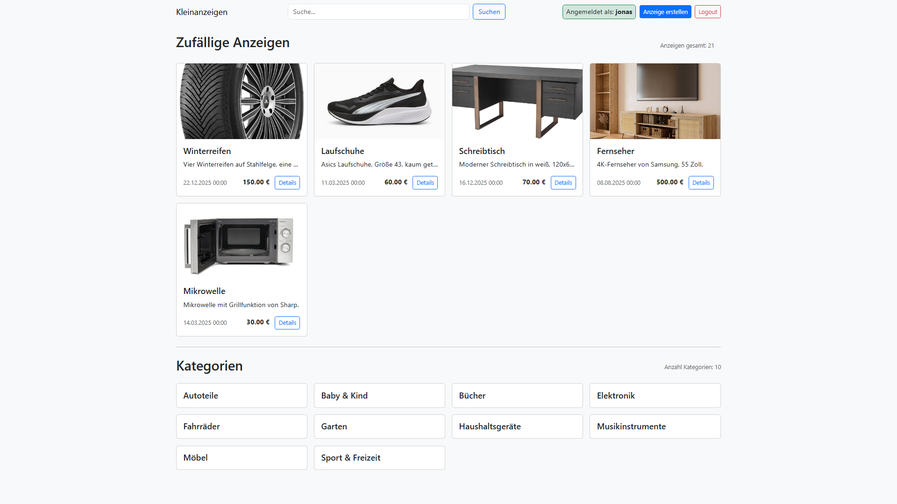
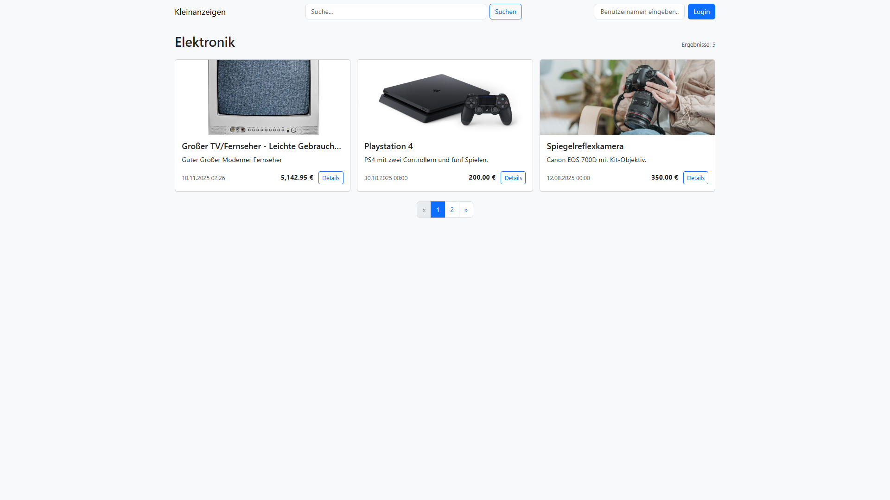
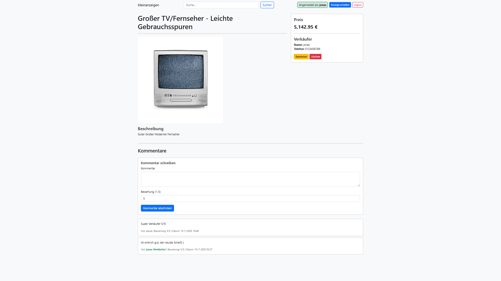
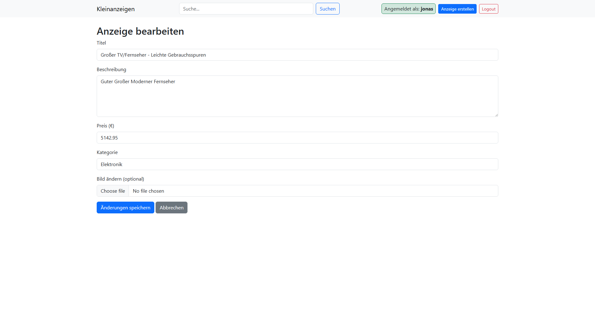
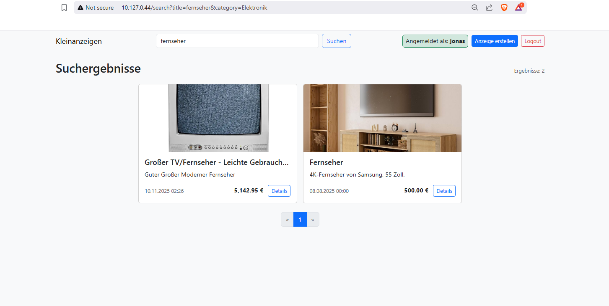

# Kleinanzeigen

Kleinanzeigen ist eine umfassende Web-Anwendung, die es Benutzern ermöglicht, auf einfache und intuitive Weise
Kleinanzeigen zu erstellen, zu verwalten und zu durchsuchen. Die Plattform ist darauf ausgelegt, eine
benutzerfreundliche Erfahrung für das Kaufen und Verkaufen von Artikeln zu bieten.

## Features

* **Anzeigenverwaltung:** Benutzer können Anzeigen mit Titel, Beschreibung, Preis, Kategorie und Bildern erstellen.
  Bestehende Anzeigen können jederzeit bearbeitet oder gelöscht werden.
* **Kategorisierung:** Um die Übersichtlichkeit zu wahren, werden können Anzeigen in Kategorien eingeteilt.
  Dies erleichtert das gezielte Suchen und Finden von Artikeln.
* **Bild-Upload:** Ein Bild sagt mehr als tausend Worte. Benutzer können Bilder zu ihren Anzeigen hochladen, um
  potenziellen Käufern einen besseren Eindruck vom Artikel zu vermitteln.
* **Kommentarfunktion:** Benutzer können zu jeder Anzeige Kommentare hinterlassen, um Fragen zu stellen oder
  Verhandlungen zu führen.
* **Leistungsstarke Suche:** Eine integrierte Suchfunktion ermöglicht es Benutzern, das gesamte Anzeigen-Portfolio
  schnell und effizient nach bestimmten Artikeln oder Stichwörtern zu durchsuchen.

## Verwendete Technologien

* **Backend:**
    * **Java 21:** Die Anwendung ist in der neuesten LTS Version von Java geschrieben.
    * **Spring Boot 3.5.7:** Das robuste Framework für die schnelle Entwicklung von Web-Anwendungen.
    * **Spring Data MongoDB:** Für die nahtlose Integration und Interaktion mit der MongoDB-Datenbank.
* **Frontend:**
    * **Thymeleaf:** Eine moderne serverseitige Java-Template-Engine für die Erstellung dynamischer Webseiten.
* **Build-Tool:**
    * **Gradle:** Ein leistungsstarkes Build-Automatisierungstool.

## Projektstruktur

Das Projekt ist logisch und übersichtlich strukturiert, um die Wartbarkeit und Weiterentwicklung zu erleichtern:

* `src/main/java`: Enthält den gesamten Java-Quellcode der Anwendung.
    * `config`: Konfigurationsklassen, z.B. für die Datenbankinitialisierung.
    * `controller`: Spring MVC-Controller, die die Anfragen aus dem Web entgegennehmen und verarbeiten.
    * `model`: Die Datenmodelle (Entitäten), die die Struktur der in der Datenbank gespeicherten Daten definieren.
    * `repository`: Spring Data-Repositories für den Zugriff auf die Datenbank.
    * `service`: Service-Klassen, die die eigentliche Geschäftslogik der Anwendung enthalten.
* `src/main/resources`: Enthält alle statischen Ressourcen und Konfigurationsdateien.
    * `templates`: Die Thymeleaf-Vorlagen für das Frontend.
* `src/test/java`: Beherbergt die Unit- und Integrationstests.

## Systemanforderungen

* **Java 21** oder eine neuere Version.
* **MongoDB 4.4** oder eine neuere Version.

## Installation der Anwendung

1. **Erstelle das Projekt mit Gradle:**
   ```bash
   ./gradlew build
   ```

2. **Verschiebe die JAR-Datei via FTP**
   ```bash
   sftp nosql@10.127.0.44
   put "...dsql-lindner-straus-kleinanzeigenplattform\build\libs\Kleinanzeigen-0.0.1-SNAPSHOT.jar"
   ```
   REM: Pfad im put-Command unvollständig, da private Verzeichnisse.

3. **Starte das Projekt:**
   ```bash
   sudo java -jar Kleinanzeigen-0.0.1-SNAPSHOT.jar
   ```
   Die Anwendung ist nun unter `http://localhost:80` erreichbar.

## Such-Tracking und -Statistiken

Die `search_logs` Collection wird beim ersten Start der Anwendung automatisch vom `DatabaseInitializer` erstellt (falls
sie noch nicht existiert) und ist auf eine Größe von 5 MB und maximal 5000 Dokumente begrenzt.

Folgende Informationen werden pro Suchanfrage gespeichert:

* **Zeitstempel:** Wann die Suche durchgeführt wurde.
* **Suchstring:** Der eingegebene Suchbegriff.
* **Standort/Radius:** Die geografische Angabe (Adresse oder Koordinaten) und der Umkreis, falls für die Suche
  verwendet.
* **Anzahl der Ergebnisse:** Wie viele Kleinanzeigen durch die Suche gefunden wurden.
* **IP-Adresse:** Die IP-Adresse des Benutzers, der die Suche durchgeführt hat.

   ```bash
            CollectionOptions options
                = CollectionOptions
                    .empty()
                    .capped()
                    .size(5242880) // 5 MB
                    .maxDocuments(5000);
            mongoTemplate.createCollection("search_logs", options);
   ```

## Datenbank-Einrichtung (MongoDB)

Die Anwendung erfordert eine laufende MongoDB-Instanz. Hier ist eine detaillierte Anleitung zur Installation und
Konfiguration von MongoDB auf einem Debian-basierten System.

### 1. MongoDB Installieren

a. **Importiere den öffentlichen GPG-Schlüssel von MongoDB:**

   ```bash
   sudo apt-get install gnupg curl
   curl -fsSL https://pgp.mongodb.com/server-6.0.asc | \
      sudo gpg -o /usr/share/keyrings/mongodb-server-6.0.gpg \
      --dearmor
   ```

b. **Erstelle eine Listen-Datei für MongoDB:**

   ```bash
   echo "deb [ arch=amd64,arm64 signed-by=/usr/share/keyrings/mongodb-server-6.0.gpg ] https://repo.mongodb.org/apt/ubuntu $(lsb_release -cs)/mongodb-org/6.0 multiverse" | sudo tee /etc/apt/sources.list.d/mongodb-org-6.0.list
   ```

c. **Lade die Paketdatenbank neu:**

   ```bash
   sudo apt-get update
   ```

d. **Installiere die MongoDB-Pakete:**

   ```bash
   sudo apt-get install -y mongodb-org
   ```

e. **Starte den MongoDB-Dienst:**

   ```bash
   sudo systemctl start mongod
   ```

### 2. MongoDB Konfigurieren

a. **Verbindung mit der MongoDB-Shell:**

   ```bash
   ./mongosh
   ```

b. **Erstellung eines administrativen Benutzers:**
   ```javascript
   use
admin
db.createUser(
    {
        user: "webService",
        pwd: "!secure_PWD!",
        roles: [{role: "root", db: "admin"}]
    }
)
   ```

c. **Aktivieren der Authentifizierung:**

   ```bash
   sudo nano /etc/mongod.conf
   ```

   ```yaml
   security:
     authorization: enabled
   ```

d. **Starte den MongoDB-Dienst neu:**

   ```bash
   sudo systemctl restart mongod
   ```
### 3. Verbindung mit MongoShell
   ``` bash
   mongosh -u "webService" -p --authenticationDatabase "admin"
   ```
### 4. Anwendungskonfiguration

```properties
spring.data.mongodb.host=localhost
spring.data.mongodb.port=27017
spring.data.mongodb.authentication-database=admin
spring.data.mongodb.database=kleinanzeigen_db
spring.data.mongodb.username=webService
spring.data.mongodb.password=!secure_PWD!
```

## Beispieldaten importieren

Um die Anwendung mit Beispieldaten zu füllen, können die bereitgestellten `beispieldaten_*.json`-Dateien verwendet werden.
Diese
Dateien enthalten einige Beispielanzeigen und Bilder, die in die Datenbank importiert werden können.

```bash
mongoimport --username webService --password '!secure_PWD!' --authenticationDatabase admin --db kleinanzeigen_db --collection ads --file beispieldaten_ads.json --jsonArray
mongoimport --username webService --password '!secure_PWD!' --authenticationDatabase admin --db kleinanzeigen_db --collection fs.files --file beispieldaten_fs_files.json --jsonArray
mongoimport --username webService --password '!secure_PWD!' --authenticationDatabase admin --db kleinanzeigen_db --collection fs.chunks --file beispieldaten_fs_chunks.json --jsonArray
```

## Indizes
```bash
db.ads.createIndex({"title":"text", "description":"text"},{ default_language: "de" })
db.ads.createIndex({"location":"2dsphere"})
```

## Screenshots
### Startseite

### Kategorien

### Anzeige - Details

### Anzeige - Bearbeiten

### Suche

###
